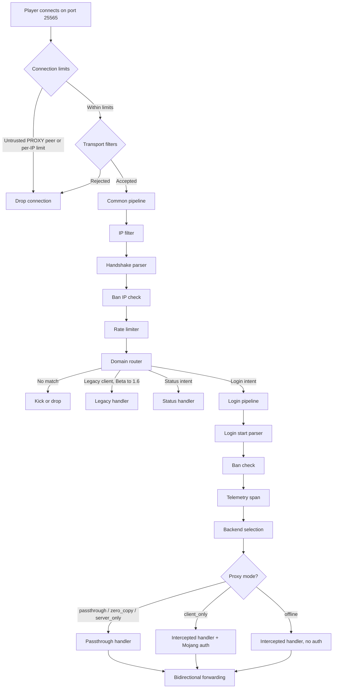

# How It Works

This page walks through what happens inside Infrarust when a Minecraft client connects. Every connection passes through two middleware pipelines, gets routed by domain, and is handed off to a proxy handler that matches the server's configured mode.

## Connection flow

## TCP accept and transport filters

Infrarust binds a TCP listener on the configured address (default `0.0.0.0:25565`). The default `max_connections` is `10000`. The listener creates a semaphore of that size and acquires a permit before each accept; once the permits run out, new connections wait until an open one is dropped. The permit is held for the lifetime of the connection. Setting `max_connections` to `0` removes the semaphore and the limit.

Each accepted connection is handed to its own task. The listener never reads from a client itself. When `receive_proxy_protocol` is on, the task first checks the peer address against `trusted_proxies`: a peer outside the list is closed without its header being read, and only a `debug` line records it. For a trusted peer the task reads the PROXY protocol header, so the real client IP is known before anything else looks at the connection. A client that connects and sends nothing, or sends its header slowly, holds up only its own connection: it keeps its `max_connections` permit until the 5-second header timeout closes it, and the listener goes on accepting others in the meantime.

Once the client IP is known, the task takes a per-IP slot. `max_connections_per_ip` (default `32`, `0` for unlimited) is the number of connections one IPv4 address or one IPv6 /64 may hold at the same time. A connection over the limit is closed, and the first refusal logs a one-time warning. The slot is held for the lifetime of the connection, like the permit.

Before any packet parsing, the task runs the transport filters that native plugins registered. A filter sees the connection's `TransportContext` (remote address, local address, the real client IP from the PROXY protocol header, connection time and a connection id) and answers `Continue` or `Reject`. A rejected connection is closed without an answer, and a filter that panics or runs past `[events] transport_filter_timeout` rejects it too. Because the filters run in the connection's task, a slow filter holds up only that connection, never the listener. Every filter that let a connection through is told when it closes. See [transport filters](../plugins/dev/architecture#layer-1-transportfilter).

## The common pipeline

Every connection runs through the common pipeline, a sequence of five middlewares executed in order. If any middleware returns `Reject` or `ShortCircuit`, the pipeline stops and no further middlewares run.

### IP filter

Checks the client IP against a global allow/deny list. Blocked IPs never reach the handshake parser.

### Handshake parser

The first real protocol work. The middleware reads bytes from the TCP stream with a 10-second timeout and attempts to decode them.

The first byte determines the client type:

- `0xFE` indicates a legacy ping (Minecraft Beta through 1.6). The middleware reads it and stores a `LegacyHello` next to an ordinary `HandshakeData` with the status intent.
- `0x02` indicates a legacy login (1.6 and older). It is stored the same way, with the login intent.
- Any other value is treated as a modern Minecraft frame (1.7+).

A legacy client does not leave the pipeline here. It continues through the ban IP check, the rate limiter and the domain router like a modern client, and the legacy handler takes over once the common pipeline has passed. A ping from Beta to 1.5 carries no hostname, so the domain router treats it as an unknown domain. The name and host lengths a legacy client declares are checked before the proxy reads them.

The legacy handler answers a ping from the backend or from the configured MOTD. For a login it checks bans, then looks at the server's `proxy_mode`: on a forwarding mode (`passthrough`, `zero_copy`, `server_only`) it fires the same player events as the passthrough handler and forwards the login to the backend. On `client_only` and `offline` the proxy would have to run the login itself, which it cannot do for these clients, so the client is kicked with "This server cannot be joined from here".

For modern clients, the middleware decodes the `SHandshake` packet (always packet ID `0x00`). A handshake frame that declares more than 2 KiB is refused before it is buffered. This packet has been stable since Minecraft 1.7, so Infrarust can proxy any protocol version without knowing its specific packet layout.

The handshake contains four fields:

| Field | Type | Purpose |
|-------|------|---------|
| `protocol_version` | VarInt | The client's protocol version number |
| `server_address` | String | The domain the player typed (e.g. `survival.mc.example.com`) |
| `server_port` | u16 | The port number |
| `next_state` | VarInt | 1 = status ping, 2 = login |

The middleware strips Forge Mod Loader markers (`\0FML\0`, `\0FML2\0`, `\0FML3\0`) from the domain, lowercases it, and stores the result as `HandshakeData` in the connection context. The raw packet bytes are preserved for forwarding to the backend later.

### Ban IP check

Runs after the handshake parser, and only for status connections: it checks the client IP against the ban system, so a banned IP cannot receive the MOTD or status ping. Login connections pass through and are checked by the ban check in the login pipeline. Legacy pings are checked here too; a legacy login is checked by the legacy handler.

### Rate limiter

Applies per-IP rate limits with separate budgets for status pings and login attempts. Uses a token-bucket algorithm. Excess connections get rejected. It is enabled by default with 10 logins and 300 status pings per 10 seconds, and it logs a one-time warning the first time it refuses a connection. See [Rate Limiting](../configuration/security/rate-limiting).

### Domain router

Looks up the cleaned domain from the handshake in the `DomainRouter`. This is a thread-safe structure backed by `DashMap` for exact matches and a `RwLock<Vec>` for wildcard patterns.

Resolution order:

1. Exact match via hash map (O(1) lookup)
2. Wildcard patterns scanned sequentially (compiled with `WildMatch` at config load time)

Exact matches always win over wildcards. If no match is found, the connection is rejected or dropped depending on the `unknown_domain_behavior` setting.

On a match, the middleware also checks the server's per-server IP filter. If the client IP is blocked for that specific server, the connection is rejected even though the domain matched.

The result is stored as `RoutingData` containing the matched `ServerConfig` and the config ID.

## Intent branching

After the common pipeline completes, the connection branches on the `next_state` field from the handshake. A legacy client goes to the legacy handler, as described above.

Status connections go to the status handler, which returns the server list ping response (MOTD, player count, favicon). If the server manager is configured, offline servers show a "starting" message. Login connections continue into the login pipeline.

## The login pipeline

Login connections run through a second pipeline: the login start parser, the ban check, telemetry, and the backend selection that orders the server's addresses.

### Login start parser

Reads and decodes the `SLoginStart` packet from the client. A frame that declares more than 5 KiB is refused before it is buffered. Extracts the player's username and UUID (UUID is present in protocol versions 1.20.2 and later). The raw packet bytes are appended to `HandshakeData.raw_packets` so the passthrough handler can forward them to the backend as-is.

### Ban check

Checks the player's username and IP against the ban system. This is the full check that catches username-based bans, as opposed to the IP-only check in the common pipeline.

### Telemetry

Creates a tracing span for the session, tagged with the server name, player username, and proxy mode. This span wraps the entire proxy handler execution for distributed tracing.

### Server wake

Starting a server that has a `server_manager` configuration is not part of the pipeline. The handler does it right before it connects the player to that server, once the plugins have picked it: a player refused at login or sent to another server never starts it. The player waits until the server is ready, and a server that cannot start fires `KickedFromServerEvent`, so a plugin can send the player elsewhere. This is how the "start server on player connect" feature works.

## Proxy handlers

After both pipelines complete, the connection is dispatched to a handler based on the server's `proxy_mode` setting.

### Passthrough handler

Used by the forwarding modes: `passthrough`, `zero_copy`, and `server_only`. The handler:

1. Fires `PreLoginEvent`, `GameProfileRequestEvent`, `PermissionsSetupEvent` and `LoginEvent`, and checks bans against the final profile (a plugin can refuse the player here, before any backend is contacted)
2. Registers a `PlayerSession` in the connection registry and fires `PostLoginEvent`
3. Fires `PlayerChooseInitialServerEvent` and `ServerPreConnectEvent` through the event bus (a plugin can deny the connection or pick another server in a forwarding mode; send-to-limbo disconnects the player, since only the intercepted handler can hold a player in limbo)
4. Starts the chosen server when it has a `server_manager` and is not online, and waits until it is
5. Connects to the backend server using the addresses from the server config, and fires `KickedFromServerEvent` when none answers or the server could not be started, so a plugin can redirect the player
6. Forwards the raw handshake and login packets to the backend and fires `ServerConnectedEvent`
7. Starts bidirectional forwarding between the client and backend TCP streams

If `domain_rewrite` is configured, the handler re-encodes the handshake packet with the new domain before forwarding. Three rewrite modes exist: `none` (forward as-is), `explicit` (use a fixed string), and `from_backend` (use the host of the first backend address).

The forwarder is selected based on proxy mode. On Linux with `zero_copy` mode, Infrarust uses `splice(2)` for kernel-level data transfer without copying bytes into userspace. Every other mode, including `zero_copy` on non-Linux platforms, uses `tokio::io::copy_bidirectional`.

When either side closes the connection, the handler fires a `DisconnectEvent` and then unregisters the session.

### Intercepted handler (client_only and offline)

The intercepted handler fully terminates the Minecraft protocol on the proxy side. Instead of forwarding raw bytes, it creates a `ClientBridge` that speaks the Minecraft protocol to the player.

In `client_only` mode, the handler performs Mojang authentication: it sends an encryption request to the client, verifies the shared secret with Mojang's session server, and enables encrypted communication. The backend server runs with `online-mode=false` since the proxy already verified the player's identity.

In `offline` mode, no authentication happens. The proxy accepts whatever username the client provides.

After authentication, the handler resolves the initial connection mode. If the server lists `limbo_handlers` that resolve, the player enters limbo (a virtual world hosted by the proxy itself) before any backend attempt, and stays there until a handler lets them through. Otherwise the handler connects to the backend and starts a session loop that reads packets from both the client and the backend, passing them through codec filter chains registered by plugins. If the backend cannot be reached, `KickedFromServerEvent` fires and the player is kicked unless a plugin sends them elsewhere.

The session loop also supports server switching: a plugin can instruct the proxy to move a player to a different backend without disconnecting them from the proxy.

## The connection context

Data flows between middlewares through the `ConnectionContext`, which carries fixed fields (peer address, client IP, the TCP stream) and a type-erased `Extensions` map. Each middleware reads what it needs from extensions inserted by previous middlewares and inserts its own data for downstream consumers.

The key extension types in order:

| Type | Inserted by | Contains |
|------|------------|----------|
| `HandshakeData` | Handshake parser | Domain, port, protocol version, intent, raw bytes |
| `LegacyHello` | Handshake parser | The ping or login of a pre-1.7 client, parsed and raw |
| `RoutingData` | Domain router | Matched server config and config ID |
| `LoginData` | Login start parser | Username and optional UUID |
| `ConnectionSpan` | Telemetry middleware | Tracing span for the session |

This design keeps middlewares decoupled. The domain router does not know about the handshake parser's internals; it just reads `HandshakeData` from the extensions map. If a middleware is removed from the pipeline, only the middlewares that depend on its output need adjustment.
